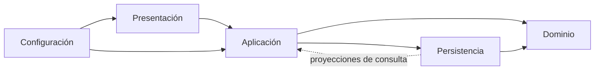

# Arquitectura

## Estilo y alcance

**Monolito modular por capas**: un proyecto Maven, un JAR, una aplicación Spring Boot y una base PostgreSQL. Los módulos agrupan funciones de negocio; no son microservicios ni despliegues independientes. Las llamadas entre casos de uso siguen siendo síncronas para conservar las transacciones existentes.

`frontend/` contiene las vistas Thymeleaf y los recursos del navegador. Se empaqueta en el mismo JAR: no es una SPA independiente del servidor.

## Estructura física

```text
src/main/java/ec/edu/epn/huertos/
  HuertosApplication.java
  <modulo>/
    presentacion/    controladores MVC, advice y adaptación HTTP
    aplicacion/     casos de uso, consultas, comandos validados y records
    dominio/        entidades, estados, valores, reglas y puertos
    persistencia/   repositorios JPA, adaptadores JDBC/EntityManager y archivos
    configuracion/  configuración técnica y propiedades
src/main/java/db/catalogo/   migración Java descubierta por Flyway
src/main/resources/         configuración y migraciones SQL
frontend/templates/         única ubicación de plantillas activas
frontend/static/            única ubicación de CSS, JS, imágenes y librerías web
```

Cada módulo tiene únicamente las capas que utiliza. Los formularios Java son contratos de entrada de aplicación: contienen validación de datos y no acceden a HTTP ni a la base. Las entidades no dependen de ellos.

## Dependencias permitidas



1. **Presentación → aplicación:** los controladores usan comandos, identificadores, enums y records. No consultan repositorios, no usan JDBC/EntityManager y no reciben entidades JPA, tampoco anidadas en records.
2. **Aplicación:** delimita transacciones, verifica permisos, invoca reglas y coordina persistencia. No depende de controladores ni accede directamente a JDBC/EntityManager.
3. **Dominio:** no depende de aplicación, persistencia, presentación ni configuración. Mantiene las anotaciones JPA del diseño original: no se declara un dominio hexagonal libre de frameworks. Relaciona otras entidades mediante identificadores.
4. **Persistencia:** contiene consultas, joins, bloqueos y almacenamiento. Los repositorios pueden devolver proyecciones de consulta de aplicación. No depende de la capa HTTP.
5. **Configuración:** conecta Spring Security, propiedades y componentes; no implementa casos de uso de negocio.

La coordinación entre módulos está en aplicación. Esta arquitectura no declara módulos autónomos, un grafo funcional acíclico ni una base por módulo. Las reglas exigidas son las de las capas y fronteras anteriores. La reorganización no debe confundirse con una implantación de arquitectura hexagonal o microservicios.

## Módulos

| Módulo | Responsabilidad |
|---|---|
| `autenticacion` | Usuarios, roles, registro, autenticación, autorización y recarga de identidad de sesión |
| `comunidades` | Membresías, cupos, invitaciones, transferencias, solicitudes, archivo/restauración, asignaciones y coordinación de eliminación |
| `huertos` | Huerto real, espacios, cerramientos, catálogo común, plantas seleccionadas y lectura del huerto virtual |
| `actividades` | Registro, participantes fijados, edición, reenvío, detalle y panel del participante |
| `evidencias` | Validación de imágenes/videos, almacenamiento, envíos, revisión y limpieza de archivos |
| `gamificacion` | Recompensas, niveles, puntos, progreso y ranking |
| `misiones` | Plantillas, dependencias, instancias por huerto y transiciones |
| `bodega` | CRUD básico de artículos, categorías y cantidades |
| `publico` | Lecturas del mapa, fichas, portada y ranking público |
| `compartido` | Excepciones de dominio, fechas, seguridad y manejo web de errores |
| `demo` | Carga sintética al arrancar con perfil demo y base sin usuarios |

## Entidades e identificadores

`Planta` persiste `especieId`, sin `@ManyToOne`. La especie se crea explícitamente en aplicación en los caminos heredados, sin cascadas. El esquema y los datos existentes no cambian.

Las lecturas resuelven la especie dentro de la transacción y construyen `PlantaVista`/`EspecieVista`. Nombre compartido y fotografía siguen procediendo de la especie; cantidad, activa, plantada y descripción local pertenecen al registro del huerto. El dibujo usa un join explícito en `PlantaVirtualLectura`.

`Especie.regiones` conserva una `@ElementCollection` de enums propios: son valores del agregado, no otras entidades. No se permiten `ManyToOne`, `OneToOne`, `OneToMany` ni `ManyToMany` entre entidades.

### Revisión de siembras integrada desde Develop

`Planta` incorpora `estadoRevision`, `plantadaEn` y `observacionesRevision`. Al pasar a plantada inicia una revisión pendiente; aprobar conserva la fecha de siembra y rechazar retira la planta de la vista virtual sin eliminar la ficha. La relación con especie sigue siendo `especieId`, sin cascadas JPA.

`huertos.aplicacion.RevisionSiembraServicio` autoriza al revisor asignado y decide bajo bloqueo pesimista. `huertos.presentacion.RevisionSiembraController` adapta las rutas `/revision/siembras`; utiliza records de aplicación. `PlantaVista` transporta el estado a las plantillas del gestor y `PlantaPlantadaVista` al huerto virtual. La revisión de una siembra no otorga las recompensas reservadas a las actividades aprobadas.

La migración `V2026111102__revision_siembra_plantas.sql` se conserva sin alterar respecto de Develop. Las ilustraciones nuevas se integran con su selección y sus pruebas; el detalle de resolución está en [integración de Develop](integracion-develop.md).

`DatosEspecie` es un valor de dominio. `FichaEspecie` lo construye antes de actualizar la entidad. `ArticuloBodega` recibe nombre, categoría y cantidad sin conocer `FormularioArticulo`.

## Frontera de lectura

`HuertosConsultaServicio` y `ConsultaActividadServicio` preparan datos autorizados para las pantallas. Los records `ComunidadVista`, `PertenenciaVista`, `HuertoVista`, `EspacioVista`, `PlantaVista`, `EspecieVista`, `ActividadVista` y `ArticuloVista` no contienen entidades JPA.

`PublicoServicio.Ficha` también contiene records en sus componentes anidados. La API JSON del mapa mantiene `HuertoMapa`. `open-in-view: false` permanece desactivado.

`SesionServicio` recarga el principal desde aplicación. Los controladores adaptan la sesión HTTP sin consultar `UsuarioRepository`. `AdminTecnicoServicio` prepara la selección de revisores y devuelve solo los datos necesarios.

## Persistencia y transacciones

Los servicios declaran lectura por defecto y los comandos mantienen transacciones de escritura. Se conservan autorización, bloqueos e idempotencia existentes.

Las consultas JDBC de misiones pertenecen a `MisionDependenciaRepository`; las fotos iniciales, a `FotoCatalogoInicialRepository`; el bloqueo de asignación, a `AsignacionBloqueo`. La eliminación se coordina en `comunidades.aplicacion.EliminacionComunidadServicio` y ejecuta SQL mediante `comunidades.persistencia.EliminacionComunidadRepository`.

La decisión sobre evidencia sigue siendo una transacción: bloquear envío, validar revisor/comunidad/estado, escribir revisión, actualizar actividad/envío, hacer flush y generar recompensas. No se introduce mensajería asíncrona ni consistencia eventual.

Flyway gobierna el esquema y Hibernate lo valida. Se mantienen versiones, SQL histórico y checksums de las migraciones. FKs compuestas, índices parciales y triggers continúan respaldando las reglas implementadas. Esta reorganización no equivale a afirmar que todas las invariantes funcionales estén completas; los pendientes están en `cambios-arquitectura.md`.

## Seguridad, errores y archivos

Se mantienen tres defensas: ruta/rol en Spring Security, autorización de cuenta/comunidad/recurso en servicios y restricciones en BD. Roles actuales: SIN_ASIGNAR, GESTOR_HUERTO, PARTICIPANTE, ADMIN_MINISTERIO_SALUD y ADMIN_TECNICO. El visitante es anónimo.

Se conservan CSRF, logout por POST, hashes, CSP, cookies y privacidad de evidencias. Los controladores de solicitudes y administración técnica capturan excepciones de negocio; los errores de integridad se traducen centralmente en `ManejadorErrores`, sin copiar mensajes del driver al flash.

`AlmacenamientoArchivos` conserva el puerto original. `ImagenValidada` y `VideoValidado` son valores de dominio. `AlmacenamientoLocal` es el adaptador de persistencia, guarda fuera de recursos estáticos y comprueba claves/rutas. El video requiere FFprobe.

Se conservan la compensación de subidas fallidas y la cola de borrados posterior al commit. No se afirma atomicidad distribuida entre BD y disco ante un cierre abrupto.

## Recursos y despliegue

Maven toma las vistas solo de `frontend/`. Las antiguas rutas de plantillas/estáticos bajo `src/main/resources` se excluyen del empaquetado y las pruebas rechazan archivos allí. `bin/` es un árbol heredado ajeno a las fuentes activas y excluido del contexto Docker; no debe editarse ni ejecutarse como esta versión.

Se conserva un despliegue con aplicación, PostgreSQL y almacenamiento de evidencias. Compose declara volúmenes para ambos. La persistencia del almacenamiento de un despliegue externo debe resolverse según su configuración; este cambio no contrata ni configura un proveedor nuevo.

## Comprobaciones ejecutables

`ArquitecturaTest` analiza bytecode productivo con ASM de Spring y verifica:

1. Dominio independiente de capas externas y HTTP.
2. Presentación sin persistencia ni entidades JPA.
3. Aplicación y persistencia sin dependencia de presentación.
4. JDBC y EntityManager únicamente en persistencia.
5. Relaciones entre entidades mediante identificadores.
6. Records sin entidades ni colecciones de entidades.
7. Servicios con frontera transaccional declarada.
8. Ubicación única de recursos de interfaz.

Se ejecuta con `mvnw.cmd -Dtest=ArquitecturaTest test`, sin Docker. La suite completa se ejecuta con mvnw.cmd verify y mantiene PostgreSQL real, por defecto mediante Testcontainers. Para una base PostgreSQL desechable ya iniciada admite `-Dhuertos.test.db.url=...`, `-Dhuertos.test.db.usuario=...` y `-Dhuertos.test.db.clave=...`.

Estas reglas no sustituyen pruebas funcionales, concurrencia, seguridad, rendimiento o revisión visual.

## Arquitectura de pruebas

Las pruebas reflejan módulo y capa en src/test/java; soporte y recorridos tienen ubicaciones explícitas. Surefire ejecuta *Test y Failsafe *IT. Véanse [guía](../src/test/README.md) y [criterios y verificación](calidad-pruebas.md).
