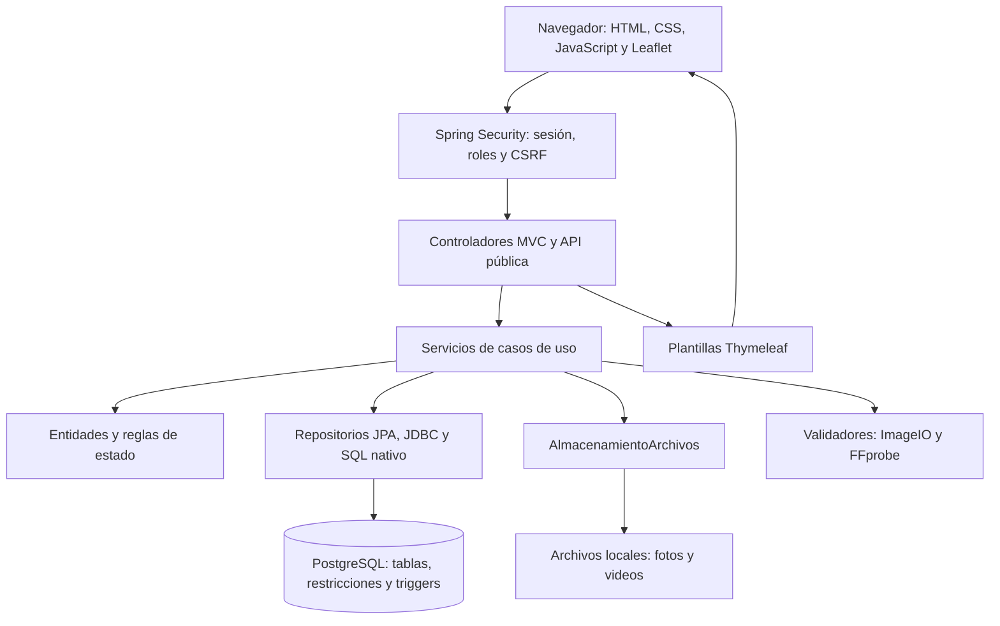

# Análisis integral del repositorio y su arquitectura

**Proyecto:** Huertos Medicinales Comunitarios / ALLPANA.
**Rama revisada:** `Develop`.
**Commit:** `9a7bd05bc0c555bfaab7291342ed854660f8094d`, confirmado contra GitHub el 12 de noviembre de 2026.
**Fecha de revisión:** 12 de noviembre de 2026, zona America/Bogota.

## 1. Dictamen

La elección de **un monolito Spring Boot con MVC, Thymeleaf y PostgreSQL es adecuada para el alcance y el tamaño actuales**. No encuentro una necesidad técnica de convertir este proyecto en microservicios ni de reescribir el frontend.

La implementación tiene fortalezas concretas: autorización por recurso en varios servicios, restricciones de integridad, libro de recompensas, transacciones y bloqueos para evitar decisiones duplicadas. El recorrido secuencial de una misión con fotografía y aprobación funcionó en ejecución real.

**La arquitectura todavía no puede darse por correcta en su conjunto.** La modularidad es principalmente una organización por paquetes; hay dependencias circulares y acceso cruzado a persistencia. La incorporación de misiones, catálogo y bodega no se propagó a todos los procesos y pruebas. Encontré fallos reproducibles en construcción, eliminación de comunidades, concurrencia de misiones, edición de cerramientos y capacidad comunitaria.

Esto apunta a un problema de integración y de protección de límites, más que a una elección equivocada del stack.

## 2. Alcance y método

Se obtuvo una instantánea exacta del commit en `auditoria-Develop-9a7bd05/`. La copia de trabajo preexistente estaba en `Ariel_Baldeon`; no se cambió esa rama ni se modificaron sus fuentes. Se actualizó la referencia remota de Develop para obtener la versión solicitada.

La revisión abarcó estructura versionada, código Java, repositorios y consultas, formularios, controladores, plantillas, JavaScript propio, organización de estilos y recursos, migraciones SQL y Java, configuración, Maven, Docker, Compose, blueprint de despliegue, scripts, pruebas y documentación. El documento DOCX de distribución del equipo se leyó como texto. Los recursos gráficos y librerías de terceros se inventariaron; no se presenta una auditoría visual individual de cada imagen ni una auditoría del código completo de Bootstrap/Leaflet.

Se combinaron inspección estática, compilación, arranque real, consultas de PostgreSQL y peticiones HTTP con sesión, CSRF y archivos multipart. Las pruebas de concurrencia se hicieron con dos peticiones reales simultáneas.

| Elemento | Cantidad observada |
|---|---:|
| Archivos versionados en la instantánea | 582 |
| Archivos Java de producción | 146 |
| Archivos Java de pruebas y soporte | 29 |
| Métodos declarados con `@Test` | 161 |
| Plantillas del frontend activo | 42 |
| Recursos de `frontend/static` empaquetados | 100 |
| Migraciones aplicadas en arranque normal | 24: 23 SQL y una Java |
| Archivos del árbol heredado `bin/` | 158 |
| Archivos `.class` versionados | 96 |

El inventario adjunto enumera los archivos, tipos, líneas y dependencias de importación. Las cantidades de archivos no son métricas de cobertura ni de calidad.

## 3. Arquitectura real

### 3.1 Ejecución y despliegue

Hay un único proyecto Maven, un único JAR y un único proceso de aplicación. Java 21, Spring Boot 4.1.2, Spring MVC, Spring Security, Thymeleaf, JPA/Hibernate, Flyway y PostgreSQL forman la aplicación. Bootstrap y Leaflet se sirven localmente. FFprobe es una dependencia del procesamiento de videos.



El diagrama muestra el flujo predominante. No todas las llamadas respetan una separación estricta: algunos controladores consultan repositorios y algunos servicios combinan aplicación, SQL y presentación.

### 3.2 Qué significa la carpeta frontend

`frontend/` separa archivos de interfaz en el repositorio. **No crea una aplicación frontend desplegable por separado.** Maven copia sus plantillas a `templates/` y sus estáticos a `static/` dentro del mismo JAR. Thymeleaf necesita el servidor Java, su modelo, sus sesiones y su CSRF para generar las páginas.

Esta separación es válida y práctica. El comentario de Maven que conserva compatibilidad con plantillas en `src/main/resources/templates` permite, sin embargo, introducir dos ubicaciones para una misma vista. Conviene elegir una ruta canónica y comprobar recursos duplicados durante la construcción. Evidencia: [pom.xml:99](https://github.com/TheJhonatan144/huertosMedicinalesComunitarios/blob/9a7bd05bc0c555bfaab7291342ed854660f8094d/pom.xml#L99) y [README.md:23](https://github.com/TheJhonatan144/huertosMedicinalesComunitarios/blob/9a7bd05bc0c555bfaab7291342ed854660f8094d/frontend/README.md#L23).

### 3.3 Modularidad y capas

La aplicación se organiza por función de negocio, con controlador, servicio, entidad, repositorio y modelos en el mismo paquete. Es un monolito con intención modular y capas lógicas.

No es una arquitectura hexagonal estricta: el dominio usa anotaciones JPA y varias entidades conocen formularios de interfaz; servicios reciben `MultipartFile`, invocan JDBC o arman textos de presentación. Tampoco son módulos independientes con encapsulación comprobada: casi todas las clases son públicas, los repositorios se usan desde otros paquetes y no existen pruebas que prohíban dependencias no deseadas.

Hay ciclos de dependencia de paquetes, por ejemplo:

- `actividades → evidencias → actividades`.
- `comunidades → huertos → comunidades`.
- `actividades → misiones → actividades`.
- `actividades → evidencias → gamificacion → actividades`.

Estos ciclos no significan automáticamente un ciclo de inyección de Spring: la aplicación arrancó. Sí indican que los límites de negocio no protegen suficientemente el impacto de un cambio.

El ejemplo más claro es `EliminacionComunidadServicio`: pertenece a evidencias, pero borra prácticamente toda la comunidad con SQL y necesita conocer tablas de otros módulos. Agregar misiones o bodega exige recordar actualizar ese servicio. El fallo de eliminación es una consecuencia observable de este diseño.

## 4. Revisión por módulo

| Paquete | Java | Función y evaluación |
|---|---:|---|
| `autenticacion` | 11 | Usuarios, principal, login, registro y provisión técnica. La autorización consulta el rol y estado actual en BD. BCrypt y restricciones del registro son buenas bases. La sesión conserva una copia del rol; algunos flujos refrescan el principal y otros requieren volver a iniciar sesión. Conviene unificar esa política. |
| `comunidades` | 37 | Membresías, cupos, invitaciones, traspasos, archivo, restauración, solicitudes y asignación de revisores. Concentra muchas responsabilidades. Tiene bloqueos y unicidad importantes, pero la reducción de cupo por cambio de tipo no se comprueba. |
| `huertos` | 28 | Ficha del huerto, espacios, cerramientos, plantas, catálogo y representación virtual. Es el paquete más heterogéneo: mezcla catálogo compartido, datos comunitarios y presentación. Tiene fallos confirmados en sincronización de cerramientos y reparto de áreas pequeñas. |
| `actividades` | 14 | Registro, edición pendiente, participantes fijos, reenvíos y panel del participante. La autorización por comunidad está en servicios. La lista de participantes está reforzada por la BD y la actividad tiene versión optimista. La frontera entre actividad, misión y evidencia quedó muy acoplada. |
| `evidencias` | 20 | Almacenamiento, validación, envíos, revisiones y eliminación. El puerto de almacenamiento es una separación útil. La aprobación protege decisiones duplicadas. Debe extraerse de aquí la coordinación de eliminación comunitaria. |
| `gamificacion` | 12 | Libro de recompensas, puntos, etapas y ranking. Es acertado derivar totales desde movimientos. La estimación del ranking conserva una hipótesis de recompensa fija que ya no aplica a las misiones. |
| `misiones` | 7 | Plantillas, dependencias y estados por huerto. El flujo secuencial funciona. El desbloqueo tiene una carrera confirmada y mezcla lectura JPA con actualización JDBC. Recurrencia y enfriamiento son campos/estados previstos, sin ciclo completo implementado; la documentación específica lo reconoce. |
| `bodega` | 6 | CRUD sencillo de artículos y cantidades. Es coherente con una bodega básica; no debe presentarse como inventario con movimientos. Verifica propiedad y comunidad operativa. No se contempla en la eliminación global. |
| `publico` | 2 | Inicio, mapa, ranking, ficha y JSON público. La API usa una proyección delimitada. Las fichas históricas siguen accesibles por ID de forma explícita en la plantilla; esto no se clasificó como fallo de privacidad. Las consultas por comunidad necesitan revisión si crece el volumen. |
| `compartido` | 6 | Seguridad, excepciones, manejo de errores y fechas. Es pequeño y reconocible. Parte del tratamiento común de errores es evitado por capturas amplias en controladores. |
| `demo` | 1 | Carga sintética bajo perfil demo y solo si no hay usuarios. Adecuada para demostración; los despliegues reales deben elegir explícitamente su perfil. |
| `db.catalogo` | 1 | Migración Java de catálogo y fotografías iniciales. Comprueba hashes y carga SQL/bytes empaquetados. Es ejecutable de arranque, aunque sus recursos se originan en `docs/catalogo`. |
| raíz | 1 | Arranque de Spring Boot, escaneo de propiedades y programación de limpieza de archivos. |

### 4.1 Autenticación y autorización

`SeguridadConfig` define una primera barrera por rutas y roles. El servicio `AutorizacionServicio` vuelve a consultar la cuenta en BD. `gestorDe`, las verificaciones de comunidad y los permisos de evidencia añaden autorización por recurso. Esto es más sólido que depender de botones ocultos.

CSRF se mantiene activo. Comprobé que un POST sin token recibe 403. Gestor y revisor autorizado pudieron recuperar una fotografía; el participante recibió 403 y el visitante fue llevado al login. Las páginas de gestor, participante, revisor y administrador técnico se generaron correctamente en los recorridos consultados.

Hay reglas residuales como `/admin/comunidades/**` con `ADMIN_COMUNIDADES`, rol que ya no está en el enum actual. Es deuda de configuración, no una vulnerabilidad demostrada. Algunos servicios auxiliares no autorizan por sí mismos y documentan que el llamador debe hacerlo, por ejemplo `DetalleActividadServicio` y `HuertoVirtualServicio.paraComunidad`. Ese contrato debe distinguirse de los casos de uso públicos del backend para evitar usos futuros inseguros.

### 4.2 Actividades, evidencias y recompensas

El registro establece participantes, los fija, guarda evidencia y mantiene sus estados. El reenvío bloquea por actividad. La decisión bloquea por envío, comprueba revisor y comunidad, escribe revisión, cambia estado y genera recompensas dentro de la misma transacción. `flush` antes de recompensar permite que los triggers consulten el estado persistido.

La unicidad de revisión por envío y de recompensa por actividad ayuda a impedir duplicados. La actividad y el envío usan `@Version`. La fotografía se compensa si la transacción termina sin confirmar. Para eliminaciones de archivos existe una cola persistida y un reintento programado.

No hay una transacción distribuida entre PostgreSQL y el sistema de archivos. Un cierre abrupto entre guardar archivo y confirmar BD puede dejar un archivo huérfano. La compensación cubre fallos controlados, no todos los cortes de proceso. Esto ya aparece como limitación en los documentos.

### 4.3 Catálogo, plantas y bodega

La especie es compartida y la planta es un registro del huerto. `plantada` y `activa` son estados distintos. La lectura del huerto virtual tiene una proyección específica y solo incluye ambas condiciones; el tope de nueve es visual. La bodega no decide qué aparece plantado. Estas separaciones son correctas.

La documentación dice que las entidades guardan solo identificadores y no asociaciones JPA; el código actual tiene `Planta → Especie` EAGER y una colección EAGER de regiones. No es incorrecto por definición, pero el documento ya no describe la arquitectura y esas cargas pueden multiplicar consultas. Quedan nombres comunes/científicos duplicados en planta y especie, mientras getters de planta privilegian especie: hay que documentar cuál es la fuente canónica y retirar rutas antiguas de edición que ya no tienen un efecto visible consistente sobre esos nombres.

El filtro de catálogo usa `findAll()` y filtra/ordena en Java. Con las 32 especies cargadas no se demostró un problema de rendimiento; para crecimiento conviene filtrar y paginar en BD.

## 5. Hallazgos priorizados

P1 significa que debe corregirse antes de considerar esta versión una entrega integrada estable. P2 identifica problemas relevantes o de mantenimiento que requieren una corrección planificada. No se asigna una puntuación numérica de calidad sin una rúbrica acordada.

### H01 — P1 — La construcción estándar y la ruta de construcción Docker fallan

**Confirmado mediante Maven sobre las fuentes originales.** `PosicionRankingTest` instancia `GamificacionServicio` con cuatro argumentos; el constructor actual requiere cinco, incluyendo `MisionServicio`.

Tanto `test` como `-DskipTests package` fallaron en `testCompile`. El Dockerfile ejecuta precisamente `-DskipTests package`, por lo que su comando de construcción contiene el mismo bloqueo. No se ejecutó Docker en esta revisión; se comprobó directamente la orden Maven equivalente.

**Evidencia:** [PosicionRankingTest.java:19](https://github.com/TheJhonatan144/huertosMedicinalesComunitarios/blob/9a7bd05bc0c555bfaab7291342ed854660f8094d/src/test/java/ec/edu/epn/huertos/gamificacion/PosicionRankingTest.java#L19), [GamificacionServicio.java:26](https://github.com/TheJhonatan144/huertosMedicinalesComunitarios/blob/9a7bd05bc0c555bfaab7291342ed854660f8094d/src/main/java/ec/edu/epn/huertos/gamificacion/GamificacionServicio.java#L26), [Dockerfile:10](https://github.com/TheJhonatan144/huertosMedicinalesComunitarios/blob/9a7bd05bc0c555bfaab7291342ed854660f8094d/Dockerfile#L10). Logs: `tmp/auditoria-unitarias.log` y `tmp/auditoria-docker-package.log`.

**Corrección:** actualizar la preparación de esa prueba y ejecutar la suite completa. No convertir la omisión de compilación de tests en la solución permanente. Una comprobación obligatoria de construcción antes de integrar habría detectado este fallo.

### H02 — P1 — No se puede completar la eliminación de comunidades con las relaciones nuevas

**Confirmado por HTTP y consulta de BD.** Se registró y aprobó una actividad de misión, se solicitó la eliminación y se aprobó desde el revisor. El borrado de actividad falló por `mision_huerto_actividad_id_fkey`. La solicitud siguió PENDIENTE y la comunidad siguió existiendo, debido al rollback.

La lista de borrados no contempla `mision_huerto`, `articulo_bodega` ni `historial_asignacion_revisor`. Las FKs de esas tablas no tienen una política de eliminación que resuelva el caso actual. Incluso una comunidad con misiones sin actividad conserva referencias al huerto.

**Evidencia:** [EliminacionComunidadServicio.java:49](https://github.com/TheJhonatan144/huertosMedicinalesComunitarios/blob/9a7bd05bc0c555bfaab7291342ed854660f8094d/src/main/java/ec/edu/epn/huertos/evidencias/EliminacionComunidadServicio.java#L49), [V2026111101__misiones_por_huerto.sql:26](https://github.com/TheJhonatan144/huertosMedicinalesComunitarios/blob/9a7bd05bc0c555bfaab7291342ed854660f8094d/src/main/resources/db/migration/V2026111101__misiones_por_huerto.sql#L26), [V2026110801__catalogo_comun_plantas_y_bodega.sql:38](https://github.com/TheJhonatan144/huertosMedicinalesComunitarios/blob/9a7bd05bc0c555bfaab7291342ed854660f8094d/src/main/resources/db/migration/V2026110801__catalogo_comun_plantas_y_bodega.sql#L38) y [V20__administrador_tecnico.sql:5](https://github.com/TheJhonatan144/huertosMedicinalesComunitarios/blob/9a7bd05bc0c555bfaab7291342ed854660f8094d/src/main/resources/db/migration/V20__administrador_tecnico.sql#L5).

**Corrección:** definir qué datos se borran y qué auditoría se conserva; resolver el vínculo circular actividad/misión y aplicar el orden o las reglas referenciales correspondientes dentro de una única coordinación comunitaria. Agregar pruebas con una comunidad creada por el flujo real, con misiones, bodega e historial de reasignación. La prueba existente usa una fábrica de datos que no reproduce todas esas relaciones.

### H03 — P1 — Dos misiones aprobadas a la vez pueden dejar bloqueada la siguiente

**Confirmado con peticiones HTTP simultáneas.** En la segunda ronda de la reproducción, los resultados persistidos fueron:

```text
INICIO_ABONO_BASE   COMPLETADA
INICIO_CERRAMIENTO  COMPLETADA
INICIO_SIEMBRA      BLOQUEADA
```

La primera ronda quedó correctamente DISPONIBLE; la segunda mostró que la corrección depende del intercalado de transacciones. Entre rondas solo se reajustaron datos en la base desechable para repetir el escenario; las aprobaciones se ejecutaron por los controladores reales.

`desbloquearDependientes` consulta estados sin serializar la decisión por huerto. Cada transacción puede ver al otro requisito todavía incompleto y ambas terminan sin desbloquear. Bloquear un envío protege una decisión individual, pero no protege una condición que abarca varias misiones.

**Evidencia:** [MisionServicio.java:104](https://github.com/TheJhonatan144/huertosMedicinalesComunitarios/blob/9a7bd05bc0c555bfaab7291342ed854660f8094d/src/main/java/ec/edu/epn/huertos/misiones/MisionServicio.java#L104). Reproducción: `tmp/auditoria-concurrencia.json` y `tmp/auditoria_concurrencia.py`.

**Corrección:** serializar las transiciones que afectan dependencias por huerto, con un orden de bloqueo consistente y lectura fresca después de adquirirlo. Otra alternativa exige una comprobación transaccional/reintento equivalente. No basta con actualizar solo la pantalla. Agregar prueba concurrente que termine comprobando las tres filas.

### H04 — P1 — Guardar el huerto conservando un tipo de cerca existente puede devolver 409

**Confirmado por formulario HTTP.** Con el grupo NATURAL ya registrado, guardar datos válidos manteniendo NATURAL falló con la restricción `uq_huerto_cerramiento_grupo`.

`sincronizar` solicita borrar los grupos y luego persiste entidades nuevas. En la ejecución observada, el INSERT con el mismo par `(huerto_id, grupo)` ocurrió antes de materializar el DELETE pendiente y PostgreSQL rechazó el duplicado. La operación completa revirtió.

**Evidencia:** [HuertoCerramientoServicio.java:29](https://github.com/TheJhonatan144/huertosMedicinalesComunitarios/blob/9a7bd05bc0c555bfaab7291342ed854660f8094d/src/main/java/ec/edu/epn/huertos/huertos/HuertoCerramientoServicio.java#L29). Log: `tmp/auditoria-app.log` y comprobaciones en `tmp/auditoria-reglas.json`.

**Corrección:** sincronizar por diferencia —conservar las filas existentes, borrar solo retiradas e insertar solo nuevas— o controlar explícitamente el vaciado antes de volver a insertar. La primera opción evita trabajo y conserva identificadores. Probar guardar dos veces la misma selección.

### H05 — P2 — Cambiar el tipo permite superar el cupo comunitario

**Confirmado por formulario HTTP.** Una comunidad BARRIO con cuatro integrantes activos pasó a PERSONA y mantuvo los cuatro. Se aisló el caso quitando la selección de cerca que disparaba H04. El resultado persistido fue `PERSONA | 4`, cuando su capacidad declarada es uno.

El control de cupo se ejecuta al incorporar integrantes. `actualizarHuerto` cambia el tipo de comunidad sin comprobar el número actual ni bloquear una reducción de capacidad incompatible. El trigger de integrantes no se activa por cambiar el tipo en comunidad.

**Evidencia:** [HuertoServicio.java:67](https://github.com/TheJhonatan144/huertosMedicinalesComunitarios/blob/9a7bd05bc0c555bfaab7291342ed854660f8094d/src/main/java/ec/edu/epn/huertos/huertos/HuertoServicio.java#L67) y [V15__cupo_comunidad_por_tipo.sql:2](https://github.com/TheJhonatan144/huertosMedicinalesComunitarios/blob/9a7bd05bc0c555bfaab7291342ed854660f8094d/src/main/resources/db/migration/V15__cupo_comunidad_por_tipo.sql#L2).

**Corrección:** validar la nueva capacidad con la comunidad bloqueada y rechazar cambios incompatibles, con respaldo en BD si se mantiene la política de defensa en capas. Probar reducciones BARRIO→CONDOMINIO, FAMILIA→PERSONA y cambios concurrentes con altas.

### H06 — P2 — Algunos errores técnicos se muestran completos en la interfaz

**Confirmado durante H02.** La página de solicitudes mostró el mensaje de JDBC, la tabla, el nombre de la FK y la sentencia SQL de borrado.

El controlador captura `RuntimeException` y muestra `e.getMessage()` como mensaje flash, evitando que `ManejadorErrores` lo convierta en un mensaje controlado. Thymeleaf escapa el contenido HTML, pero eso no evita divulgar detalles internos.

**Evidencia:** [SolicitudesComunidadController.java:32](https://github.com/TheJhonatan144/huertosMedicinalesComunitarios/blob/9a7bd05bc0c555bfaab7291342ed854660f8094d/src/main/java/ec/edu/epn/huertos/comunidades/SolicitudesComunidadController.java#L32). Existe el mismo patrón en administración técnica.

**Corrección:** capturar excepciones de negocio concretas y centralizar las inesperadas con mensaje público genérico y registro del detalle técnico. La respuesta al usuario debe conservar contexto útil, sin copiar mensajes del driver.

### H07 — P2 — El reparto de áreas puede generar un espacio de área cero

**Confirmado por formulario HTTP.** Área total `0.06 m²`, cuatro diseños: el servicio calcula `0.02` para los tres primeros, consume `0.06` y deja `0.00` para el último. La validación inicial admite `0.06 >= 4 × 0.01`, pero el CHECK de PostgreSQL rechaza el último espacio y la respuesta termina en 409.

**Evidencia:** [EspacioHuertoServicio.java:38](https://github.com/TheJhonatan144/huertosMedicinalesComunitarios/blob/9a7bd05bc0c555bfaab7291342ed854660f8094d/src/main/java/ec/edu/epn/huertos/huertos/EspacioHuertoServicio.java#L38). Log: `espacio_huerto_area_m2_check` en `tmp/auditoria-app.log`.

**Corrección:** repartir unidades mínimas enteras —centésimas de m²— y distribuir el resto manteniendo cada espacio positivo. Alternativamente, definir un mínimo funcional mayor y validarlo de forma consistente. Probar totales pequeños y números de espacios que no dividan exactamente el área.

### H08 — P2 — El ranking promete una recompensa fija que ya no existe para todas las actividades

**Confirmado por lectura y por una recompensa persistida de misión.** La misión inicial otorgó cinco puntos comunitarios y uno de progreso. Sin embargo, el cálculo de actividades para alcanzar al siguiente usa el valor global de veinte y la vista dice «Cada actividad aprobada suma … puntos».

Los puntos del ranking se suman correctamente; el defecto está en la explicación y estimación mostrada al usuario. Las plantillas de misión incluyen recompensas diferentes, de cinco a veinticinco puntos comunitarios en la ruta actual.

**Evidencia:** [GamificacionServicio.java:147](https://github.com/TheJhonatan144/huertosMedicinalesComunitarios/blob/9a7bd05bc0c555bfaab7291342ed854660f8094d/src/main/java/ec/edu/epn/huertos/gamificacion/GamificacionServicio.java#L147) y [huerto-virtual.html:139](https://github.com/TheJhonatan144/huertosMedicinalesComunitarios/blob/9a7bd05bc0c555bfaab7291342ed854660f8094d/frontend/templates/fragmentos/huerto-virtual.html#L139).

**Corrección:** mostrar los puntos que faltan y aclarar que las recompensas varían, o calcular una estimación identificando el tipo concreto de actividad. No usar una cifra universal para misiones y actividades libres.

### H09 — P2 — Los límites entre módulos no están protegidos

**Confirmado por dependencias estáticas.** Hay imports y consultas directas a modelos/repositorios de otros paquetes, ciclos y coordinadores ubicados en módulos de detalle. Controladores como `GestorPanelController` y `CuentaArchivadasController` acceden a `UsuarioRepository` para reconstruir la sesión.

**Impacto:** ampliar un módulo obliga a conocer cambios fuera de él; H01 y H02 muestran dos efectos concretos. La modularidad no queda garantizada por los nombres de carpetas.

**Corrección:** definir fachadas pequeñas y dependencias permitidas. La coordinación de revisión/actividad/misión/recompensa y la eliminación comunitaria merecen casos de uso explícitos. Agregar comprobaciones de dependencias antes de pensar en separar procesos.

### H10 — P2 — La documentación no es una descripción consistente de esta versión

**Confirmado.** `docs/arquitectura.md` describe migraciones V1–V15 y entidades sin asociaciones JPA, y omite módulos actuales. El README todavía muestra rutas antiguas y una referencia a migraciones V1–V3. `alcance-prototipo.md` sitúa bodega/misiones fuera del alcance y contiene una afirmación de que no hay registro público; el código sí tiene registro y la documentación específica sí incluye cambios posteriores.

El DOCX de distribución también conserva decisiones anteriores: tope visual de una o dos plantas, cupo general de veinticinco y misiones fuera del primer entregable. No permite, por sí solo, decidir cuál es el alcance vigente. `pruebas.md` conserva una ejecución de 63 pruebas que no representa el estado de las 161 pruebas declaradas hoy.

**Corrección:** publicar un alcance vigente y actualizar arquitectura, roles, módulos, ruta frontend, migraciones, requisitos de FFprobe y resultados de pruebas. Mantener las decisiones históricas identificadas como históricas.

### H11 — P2 — Falta una barrera automática visible para integrar cambios

En este commit no hay workflows de GitHub Actions versionados. La consulta de la rama devolvió `protected: false`. Esto no demuestra ausencia de toda integración externa o reglas organizativas; sí indica que no hay una comprobación versionada visible que explique cómo se bloquean regresiones como H01.

**Corrección:** una comprobación obligatoria de construcción y pruebas sobre la rama de integración. La validación debería construir el mismo artefacto que se despliega y ejecutar también los escenarios integrados nuevos. No alcanza con que cada integrante pruebe solo su paquete.

### H12 — Riesgo operativo — La configuración de despliegue no asegura persistencia de evidencias

Compose declara volúmenes para base y evidencias. `render.yaml` usa el plan free y no declara un disco para evidencias; la documentación de despliegue advierte que esas fotos/videos no se conservan en ese esquema. No se verificó un servicio Render real ni sus condiciones comerciales actuales.

La aplicación guarda archivos en disco local mientras los metadatos y recompensas permanecen en PostgreSQL. Si se pierde ese disco, una actividad aprobada puede seguir en el historial y tener puntos, pero la evidencia ya no se puede recuperar. Varias réplicas con discos independientes presentan el mismo problema de acceso.

**Corrección:** definir el almacenamiento persistente elegido, sus copias de seguridad y su restauración junto con la BD. `AlmacenamientoArchivos` facilita esa evolución. La prioridad depende de si el despliegue será desechable de demostración o conservará evidencias reales.

## 6. Modelo de datos y migraciones

El uso de Flyway con `ddl-auto: validate` y `open-in-view: false` es coherente: el esquema lo gobiernan migraciones y se comprueba al iniciar. El arranque normal aplicó las 24 migraciones correctamente sobre una base vacía PostgreSQL 17.11 y la migración de catálogo dejó 32 especies.

Las familias del modelo son:

- Identidad y comunidad: usuario, comunidad, integrante, invitación, asignación e historial de asignaciones.
- Gestión: huerto, espacios, cerramientos, especie/regiones, planta y artículos de bodega.
- Actividad y revisión: actividad, participantes, envíos y revisiones.
- Gamificación: recompensas individuales/comunitarias y plantillas, dependencias e instancias de misiones.
- Procesos de soporte: solicitudes comunitarias, cola de borrado y fotografías iniciales del catálogo.

Las migraciones V1–V3 forman el núcleo; V4–V15 desarrollan usuarios/comunidades/cupos; V18–V22 añaden espacios, video, administración técnica y cerramientos; las migraciones fechadas incorporan catálogo, contexto de fichas, carga inicial y misiones. Los saltos V16/V17 no son por sí mismos un error. La mezcla de numeración pequeña y fechada exige cuidar el orden al agregar versiones futuras y probar actualizaciones desde una BD existente.

Las FKs compuestas de participantes y recompensas impiden mezclar comunidad en esas relaciones. Los índices parciales controlan una pertenencia activa por usuario y un envío pendiente/aprobado por actividad. Los triggers refuerzan inmutabilidad, cupo, revisor y actividad aprobada antes de recompensar.

No todas las invariantes están respaldadas igual: la coherencia bidireccional de misión/actividad y el cupo al modificar tipo necesitan trabajo. Las reglas están repartidas entre Java y PL/pgSQL; es una decisión viable, pero cada regla debe indicar cuál es su autoridad, qué defensa la duplica y qué prueba cubre la interacción.

## 7. Frontend y presentación

Las plantillas comparten `fragmentos/base`, componentes, fragmentos de plantas/bodega y huerto virtual. Los controladores suelen seguir el patrón POST→redirect para evitar reenvío de formularios. Los scripts propios mejoran navegación, confirmaciones, animaciones y mapa sin almacenar reglas de negocio.

El mapa construye popups con nodos DOM y `textContent`; existe una lista alternativa renderizada por servidor. La CSP limita scripts al propio origen y permite los mosaicos de OpenStreetMap. Hay soporte de movimiento reducido y descripciones textuales en la escena virtual. Son buenas decisiones observables en código; no constituyen certificación de accesibilidad.

Los estilos están separados por pantallas y componentes. El frontend sigue teniendo un contrato fuerte con nombres de atributos de modelo y records de Java. Conviene comprobar páginas con estados vacíos, errores de validación, rechazo, comunidad archivada/eliminación pendiente y todos los roles, no solo con datos demo completos.

Se probaron peticiones y HTML generado, no una sesión gráfica de navegador. Por tanto, no se afirma que el diseño móvil, el contraste, la navegación por teclado, la reproducción de video o los mosaicos reales estén verificados visualmente.

## 8. Seguridad y archivos

Fortalezas observadas:

- Contraseñas con encoder delegante y bcrypt; validación de bytes para contraseña en registro público.
- Autorización por rol y recurso en los caminos críticos examinados.
- CSRF activo, logout por POST y cookies HttpOnly/SameSite configuradas.
- Validación de JPEG/PNG por firma y decodificador, límites de dimensiones y tamaño, claves UUID y verificación de ruta.
- Evidencias fuera de recursos estáticos y respuesta con `no-store`/`nosniff`.
- Proceso Docker configurado con usuario sin privilegios.

Aspectos a completar:

- H06 evita el manejo central de errores y divulga detalles técnicos.
- No hay límite de intentos de login implementado en el código revisado; decidir su necesidad para el entorno de uso.
- La provisión y retirada de cuentas institucionales necesitan una política consistente; no hay un flujo general de cambio obligatorio de contraseña temporal.
- La prueba de video no tiene una clase dedicada equivalente a la de imágenes. FFprobe se invoca dentro de la petición y transacción: hay que medir latencia y concurrencia si se usa de forma intensiva.
- El validador de video espera la salida del proceso antes de leer toda su tubería. Una salida grande puede agotar el tiempo aun con un archivo válido; es un riesgo de implementación pendiente de reproducir, no un fallo que se afirme ocurrido.
- Las compensaciones de archivos no sustituyen una reconciliación de huérfanos ni una estrategia de restauración.

No se realizó pentest, fuzzing, análisis de vulnerabilidades de dependencias, auditoría jurídica de datos personales ni comprobación de vigencia de todas las versiones. No se afirma cumplimiento normativo ni ausencia de vulnerabilidades.

## 9. Rendimiento y mantenibilidad

`huertosParaMapa` hace búsquedas de huerto y sumas de puntos/progreso por comunidad. La bandeja e historial de revisión ejecutan lecturas por elemento. El panel del gestor obtiene la lista completa de actividades para contar estados, y varias listas carecen de paginación.

Esto implica crecimiento del trabajo con el número de filas y posibles patrones N+1; no se midió un tiempo de respuesta bajo carga. Las cargas EAGER del catálogo pueden agregar consultas. La proyección `PlantaVirtualLectura` es un ejemplo útil para orientar otras lecturas específicas.

Las mejoras proporcionadas serían: agregados para mapa/panel, paginación de actividades e historial, filtros de catálogo en BD y medición de consultas antes de optimizar. Un cache o una base distinta no son requisitos demostrados.

La mezcla de formato muy compacto con clases más legibles dificulta revisar cambios entre autores. También hay códigos de diseño/suelo/tipos repetidos en formularios, servicios y SQL. Conviene centralizar su representación en Java y conservar constraints de BD con pruebas de correspondencia.

`bin/` contiene un árbol antiguo con `.class`, plantillas, configuración, documentación y otro POM. El build principal no lo usa como fuente. Debe excluirse del versionado futuro y del contexto de Docker para evitar confusión y peso; antes de retirarlo hay que comprobar que no contiene trabajo exclusivo. No se eliminó durante esta revisión.

## 10. Verificación realizada y límites

### 10.1 Construcción original

| Comprobación | Resultado |
|---|---|
| Compilación de las 146 fuentes de producción, Java 21 | Correcta |
| `test`, seleccionando `*Test` | Falla al compilar las pruebas, H01 |
| `-DskipTests package`, orden del Dockerfile | Falla al compilar las pruebas, H01 |
| `-Dmaven.test.skip=true package` | Genera JAR; se usó únicamente para poder diagnosticar ejecución |
| Arranque de ese JAR contra PostgreSQL temporal | Correcto; Hibernate valida el esquema |
| Flyway de arranque normal | 24 migraciones aplicadas; catálogo inicial de 32 especies |

### 10.2 Suite auxiliar de diagnóstico

Para conocer el estado del resto sin arreglar ni alterar las fuentes originales, se creó un POM auxiliar y una copia temporal de las pruebas:

1. Se excluyó `PosicionRankingTest`, que contiene siete métodos y no compila.
2. En la copia se sustituyó solo la base `PruebaIntegracion`: en lugar de arrancar Testcontainers, apuntó a una BD PostgreSQL 17.11 temporal separada, `auditoria_tests`.
3. Se conservaron las demás pruebas y las fuentes productivas originales, recursos y perfiles. Se fijó el directorio de trabajo correcto.
4. Resultado: **154 pruebas ejecutadas, cero fallos, cero errores, cero omitidas, BUILD SUCCESS**.

Esto **no equivale a afirmar que `mvn test` original pasa**, ni que la ruta Testcontainers/Docker haya sido ejecutada. Es evidencia adicional de las pruebas restantes bajo el adaptador local descrito. La suite original requiere arreglar H01 y repetirse en su configuración normal.

Un primer intento auxiliar dentro del sandbox encontró permisos del sistema de archivos y no se usa como resultado funcional. La ejecución final descrita arriba completó fuera de esa limitación. Evidencia final: `tmp/auditoria-suite-diagnostica.log` y reportes XML en `tmp/auditoria-unit-target/surefire-reports/`.

### 10.3 Comprobaciones HTTP adicionales

- Páginas públicas y privadas representativas, login de los cuatro roles registrados, catálogo y formularios consultados: respondieron con HTML esperado.
- El cliente siguió redirecciones: un 200 final en `/login` para visitante significa que la ruta privada no entregó su contenido.
- POST sin CSRF: 403.
- Registro de actividad de misión con fotografía PNG real, aprobación y persistencia de recompensa: correcto, cinco puntos comunitarios y uno de progreso.
- Siguiente misión secuencial: DISPONIBLE.
- Segunda aprobación: no agregó una segunda recompensa comunitaria.
- Fotografía: 200 para gestor/revisor, 403 para participante y redirección a login para anónimo.
- Eliminación: fallo reproducido y rollback, H02; mensaje técnico visible, H06.
- Aprobación concurrente de dependencias: bloqueo incorrecto reproducido en segunda ronda, H03.
- Conservación de cerca al guardar: conflicto por duplicado, H04.
- Cambio a PERSONA: persistió con cuatro integrantes activos, H05.
- Reparto de 0.06 m² entre cuatro espacios: conflicto por área cero, H07.

Estas pruebas usan exclusivamente datos sintéticos en una instancia temporal local. No se tocaron datos del despliegue ni se enviaron cambios a GitHub.

## 11. Arquitectura recomendada para evolucionar

Mantendría un único despliegue con límites de módulo más claros:

- **Identidad:** cuentas, credenciales, permisos y actualización de sesión.
- **Comunidades:** pertenencia, invitaciones, solicitudes, responsables y ciclo de vida comunitario.
- **Huertos:** configuración física, espacios, cerramientos y plantas registradas.
- **Catálogo:** especies comunes, fuentes y fotografías de catálogo.
- **Actividades:** registro y participantes.
- **Evidencias y revisión:** archivos y decisiones autorizadas.
- **Misiones:** disponibilidad, dependencias y transiciones.
- **Gamificación:** movimientos de recompensa y consultas de progreso/ranking.
- **Bodega:** artículos básicos comunitarios.
- **Consultas públicas y paneles:** modelos de lectura preparados para sus pantallas.

No es necesario crear un proyecto Maven por cada nombre. Primero conviene fijar contratos y dirección de dependencias, reducir acceso cruzado a repositorios y agregar comprobaciones automáticas de esas reglas.

La aprobación puede seguir siendo sincrónica y atómica. Un caso de uso coordinador explícito debería gobernar la revisión, actualización de actividad, transición de misión y recompensa. Cambiar todo a eventos asíncronos sin resolver atomicidad haría más difícil garantizar que una aprobación y sus puntos queden consistentes.

La eliminación debe pertenecer al ciclo de vida comunitario y tener una política explícita por agregado, incluyendo vínculos de auditoría. Los detalles del medio de archivo deben permanecer tras `AlmacenamientoArchivos`.

## 12. Orden concreto de corrección

| Orden | Trabajo | Criterio para darlo por resuelto |
|---|---|---|
| 1 | H01 y comprobación obligatoria de construcción | `test` y `-DskipTests package` pasan en una copia limpia; imagen se construye |
| 2 | H02, H03 y H04 | Eliminación con todos los módulos; desbloqueo bajo concurrencia; guardar dos veces misma cerca |
| 3 | H05 y H06 | Ningún cambio de tipo excede capacidad; errores técnicos quedan en logs |
| 4 | H07 y H08 | Repartos válidos conservan suma y áreas positivas; ranking explica recompensas variables |
| 5 | Límites de módulos y nuevas pruebas de integración | Dependencias permitidas comprobadas; fábricas representan comunidades reales con misiones |
| 6 | Persistencia, restauración y documentación vigente | Ensayo de restauración BD+archivos y documentos consistentes con el commit |
| 7 | Rendimiento y revisión visual | Medición de carga acordada y comprobación de navegador por estados y roles |

La prioridad es estabilizar los flujos integrados y la construcción. El stack actual puede sostener esa mejora; la evidencia encontrada no justifica una reescritura completa.

## 13. Evidencias adjuntas

- Inventario de todos los archivos: [INVENTARIO_Develop_9a7bd05.md](<C:/Users/MY HP/OneDrive/Documentos/ChatGPT/CALIDAD/INVENTARIO_Develop_9a7bd05.md>).
- Fallo de tests original: [auditoria-unitarias.log](<C:/Users/MY HP/OneDrive/Documentos/ChatGPT/CALIDAD/tmp/auditoria-unitarias.log>).
- Fallo de la orden Maven usada en Docker: [auditoria-docker-package.log](<C:/Users/MY HP/OneDrive/Documentos/ChatGPT/CALIDAD/tmp/auditoria-docker-package.log>).
- Empaquetado diagnóstico: [auditoria-package.log](<C:/Users/MY HP/OneDrive/Documentos/ChatGPT/CALIDAD/tmp/auditoria-package.log>).
- Arranque y errores reales: [auditoria-app.log](<C:/Users/MY HP/OneDrive/Documentos/ChatGPT/CALIDAD/tmp/auditoria-app.log>).
- Suite auxiliar final: [auditoria-suite-diagnostica.log](<C:/Users/MY HP/OneDrive/Documentos/ChatGPT/CALIDAD/tmp/auditoria-suite-diagnostica.log>).
- Resultados del recorrido HTTP: [auditoria-http.json](<C:/Users/MY HP/OneDrive/Documentos/ChatGPT/CALIDAD/tmp/auditoria-http.json>).
- Resultados concurrentes: [auditoria-concurrencia.json](<C:/Users/MY HP/OneDrive/Documentos/ChatGPT/CALIDAD/tmp/auditoria-concurrencia.json>).
- Resultados de formularios/cupo/área: [auditoria-reglas.json](<C:/Users/MY HP/OneDrive/Documentos/ChatGPT/CALIDAD/tmp/auditoria-reglas.json>).

Los scripts `tmp/auditoria_http.py`, `tmp/auditoria_concurrencia.py`, `tmp/auditoria_reglas.py`, `tmp/auditoria_pg.py` y `tmp/auditoria_unit_pom.py` documentan las comprobaciones. Las reproducciones modifican datos sintéticos y deben usarse solo con la instancia desechable prevista. La comprobación no certifica todos los requisitos: los documentos formales RF/RNF/RB que el propio repositorio declara ausentes siguen sin estar disponibles en `docs/referencias`.
