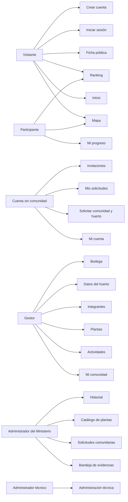
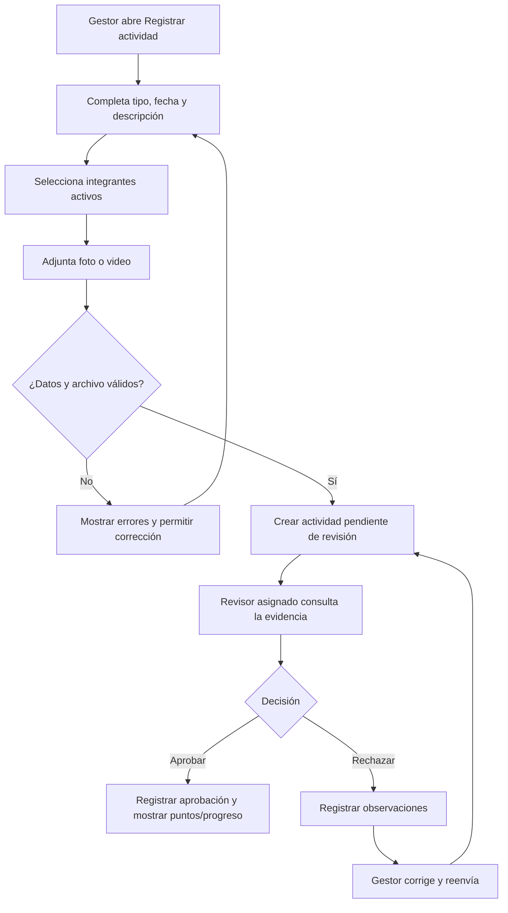

# Diseño de interfaces de ALLPANA

**Borrador de trabajo · Basado en la aplicación actual en Develop · Alcance V1 pendiente de confirmación**

## Propósito

Este borrador describe las pantallas y recorridos de ALLPANA tal como están implementados en la versión actual del sistema. Sirve como base para el apartado de diseño de interfaces de `03_Diseno_V1.pdf` y para coordinar la integración con Ariel.

La lista es un inventario del producto. No afirma que todas las pantallas o funciones formen parte de la entrega V1. La clasificación se completa después de acordar el alcance con la persona responsable de requisitos.

## Identidad visual y estructura común

La interfaz utiliza la marca ALLPANA, con una barra superior café oscuro, fondos claros, superficies blancas y acentos verdes y terracota. La portada combina fotografía de paisaje, títulos serif, textos breves y acciones principales. El interior reutiliza navegación, controles, formularios, tarjetas, alertas, tablas y estados de progreso.

Paleta registrada en `frontend/static/css/paleta.css`:

| Función visual | Color |
|---|---|
| Café oscuro de navegación | `#3B2A18` |
| Tinta de títulos | `#110102` |
| Verde principal | `#008405` |
| Terracota de acento | `#B7532C` |
| Verde suave | `#BBD88C` |
| Fondo | mezcla clara de gris cálido y blanco |
| Superficie de tarjetas | `#FFFFFF` |

La plantilla compartida presenta el logo, navegación según el rol, un enlace para saltar al contenido, área principal y pie institucional. En pantallas estrechas, el menú se contrae. Los formularios muestran etiquetas, ayudas, controles de Bootstrap, alertas generales y errores asociados al campo.

## Navegación por rol

## Inventario de pantallas actuales

| Rol o área | Pantalla y ruta | Componentes y propósito observados |
|---|---|---|
| Público | Inicio `/` | Presentación de ALLPANA, explicación del recorrido, resumen de comunidades/ranking y accesos a mapa y registro. |
| Público | Mapa `/mapa` | Búsqueda por comunidad o lugar, filtros por provincia y etapa, tarjetas de resultados, mapa Leaflet, marcadores y alternativa de lista. |
| Público | Ficha `/comunidades/{id}` | Nombre y ubicación pública, estado, métricas comunitarias, huerto virtual, progreso, espacios, mapa y plantas visibles. No presenta contactos personales ni evidencias. |
| Público | Ranking `/ranking` | Tabla de posición, comunidad, provincia y puntos comunitarios; los empates comparten posición. |
| Cuenta | Registro `/registro` y acceso `/login` | Formularios de cuenta e inicio de sesión con mensajes de error. La cuenta nueva comienza sin comunidad ni rol comunitario. |
| Cuenta sin comunidad | Cuenta, solicitudes e invitaciones: `/cuenta`, `/cuenta/solicitudes-comunidad`, `/cuenta/invitaciones` | Información de cuenta, seguimiento de solicitudes y respuesta a invitaciones. |
| Cuenta sin comunidad | Alta `/cuenta/comunidad/nueva` | Formulario por grupos: comunidad y responsable, ubicación, ficha del huerto, diseños, suelo, fuente de agua, abono y cercamiento. |
| Gestor | Panel `/gestor` | Resumen de integrantes/cupo, puntos, actividades por estado, progreso del huerto virtual y accesos a acciones frecuentes. |
| Gestor | Integrantes `/gestor/integrantes` | Integrantes, invitaciones, cupos y acciones autorizadas sobre pertenencia y gestión. |
| Gestor | Huerto `/gestor/huerto` | Edición de la comunidad y el huerto; ubicación, área, espacios/diseños, suelo, agua, abono y cerramientos. |
| Gestor | Plantas y siembra `/gestor/plantas`, `/gestor/plantas/{id}/siembra` | Plantas de la comunidad, activación y estado de siembra. |
| Gestor / MSP | Catálogo `/gestor/plantas/catalogo` | Consulta de especies y filtros; la edición de fichas depende del permiso de Ministerio. |
| Gestor | Bodega `/gestor/bodega` | Consulta y mantenimiento de artículos del huerto. Su clasificación en V1 queda pendiente de acuerdo. |
| Gestor | Actividades `/gestor/actividades` y `/gestor/actividades/nueva` | Lista con fecha, tipo, participantes, envíos y estado; formulario para registrar o editar una actividad. |
| Gestor | Detalle y reenvío `/gestor/actividades/{id}` | Estado, participantes, historial de evidencias y revisiones; al rechazar, aparece el formulario de corrección y reenvío. |
| Participante | Progreso `/participante` | Panel de progreso individual y acceso a información pública. |
| Ministerio | Revisión `/revision`, `/revision/envios/{envioId}` | Bandeja, detalle de actividad/evidencia, participantes, decisión y observaciones; incluye el historial de envíos. |
| Ministerio | Solicitudes `/revision/solicitudes-comunidad` | Revisión de solicitudes de creación o eliminación comunitaria. |
| Ministerio | Historial `/revision/historial` | Consulta de revisiones previas. |
| Administración técnica | Panel `/admin-tecnico` | Creación de cuentas revisoras y reasignación controlada de comunidades. |
| Sistema | Errores `/403`, `/404`, `/500` y error de regla | Mensajes para acceso denegado, recurso no encontrado, fallo inesperado y regla de negocio. |

## Formularios y validaciones visibles

Estas son validaciones identificadas en las plantillas y clases actuales. Deben permanecer alineadas con la validación del servidor.

| Formulario | Datos principales | Validaciones/interacciones actuales |
|---|---|---|
| Registro | Nombre, usuario, correo, teléfono, nacimiento, género, nivel, talentos y claves | Campos requeridos; usuario de 3–50 caracteres con letras, números, punto, guion o guion bajo; correo válido; teléfono validado; fecha no futura; talentos opcionales hasta 2000 caracteres; contraseña y confirmación entre 8 y 72 caracteres. |
| Solicitud de comunidad y huerto | Datos de comunidad, ubicación y ficha del huerto | Campos requeridos; coordenadas de Ecuador entre latitud `-5.1` y `1.8` y longitud `-92.5` y `-75`; área mayor que cero; selección visual de suelo y diseños; errores generales y por campo. |
| Actividad | Tipo, fecha, descripción, participantes y archivo | Fecha actual o anterior; descripción requerida hasta 2000 caracteres; al menos un integrante elegible; JPEG/PNG hasta 5 MiB o video MP4 H.264 hasta 50 MiB y 120 segundos. |
| Revisión de evidencia | Decisión y observaciones | Aprobar o rechazar; observaciones obligatorias para rechazar; envío revisado muestra su estado e historial. |
| Corrección y reenvío | Datos de actividad, comentario opcional y nuevo archivo | Se habilita tras rechazo; requiere nueva evidencia; se conserva el historial anterior. |

## Flujo funcional principal de la interfaz

## Capturas representativas para integrar con Ariel

La revisión en el navegador confirmó la apariencia actual de inicio, mapa, ficha pública, ranking y registro. Para la versión integrada del PDF, conviene añadir capturas desde el navegador del equipo y con datos sintéticos de estas pantallas:

1. Inicio y navegación pública.
2. Mapa con filtros y resultados.
3. Ficha pública con huerto virtual.
4. Panel del gestor y formulario de huerto.
5. Registro de actividad, incluyendo selección de participantes y evidencia.
6. Revisión de evidencia con controles de aprobación/rechazo.
7. Formularios de catálogo/siembra y bodega, si Cami confirma que corresponden al alcance V1.

En cada captura, indiquen rol y propósito de la pantalla. No incluyan contraseñas, datos personales reales ni archivos de evidencia de personas.

## Pendientes para cerrar este apartado

- Confirmar con la persona 1 qué pantallas y flujos se consideran parte de V1.
- Revisar con Ariel que las pantallas seleccionadas coincidan con la arquitectura y los diagramas compartidos.
- Insertar capturas de pantallas autenticadas tomadas por el equipo con cuentas de demostración.
- Revisar si la plantilla del curso exige una estructura o cantidad específica de pantallas.

## Archivos consultados

- `frontend/templates/fragmentos/base.html` — navegación y estructura compartida.
- `frontend/templates/publico/` — inicio, mapa, ficha comunitaria y ranking.
- `frontend/templates/auth/`, `cuenta/`, `gestor/`, `participante/`, `revision/` y `admin-tecnico/` — pantallas por área/rol.
- `frontend/static/css/paleta.css` — identidad visual y componentes de marca.
- `src/main/java/` — rutas de controladores y validaciones del servidor.
